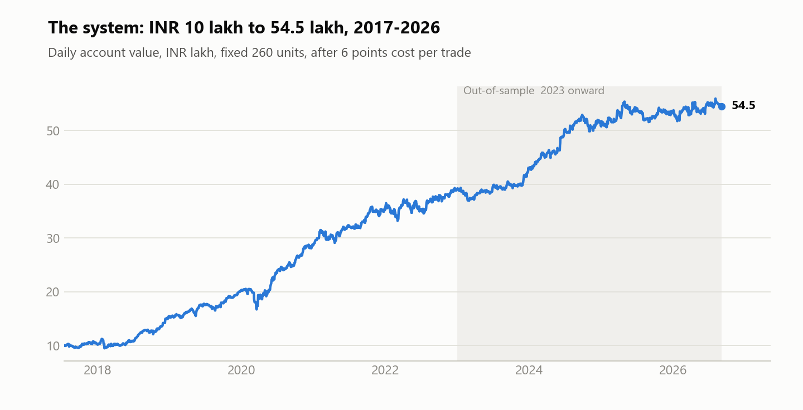
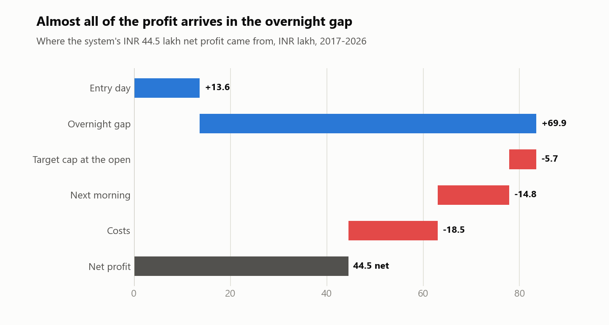
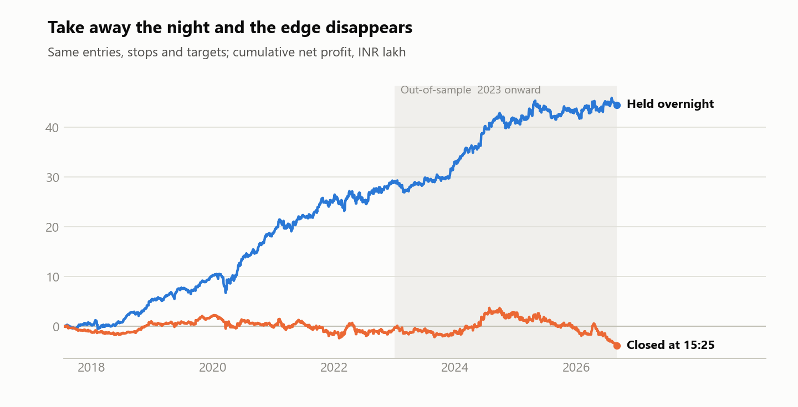
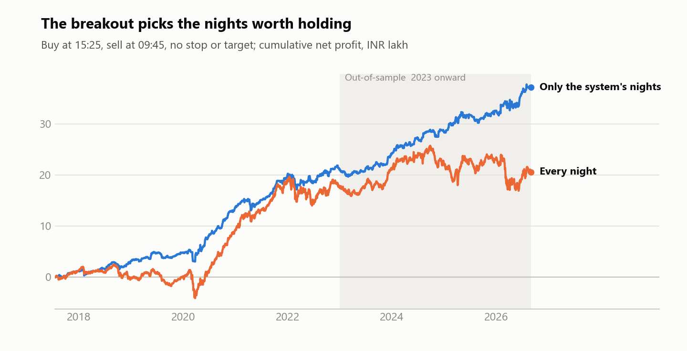
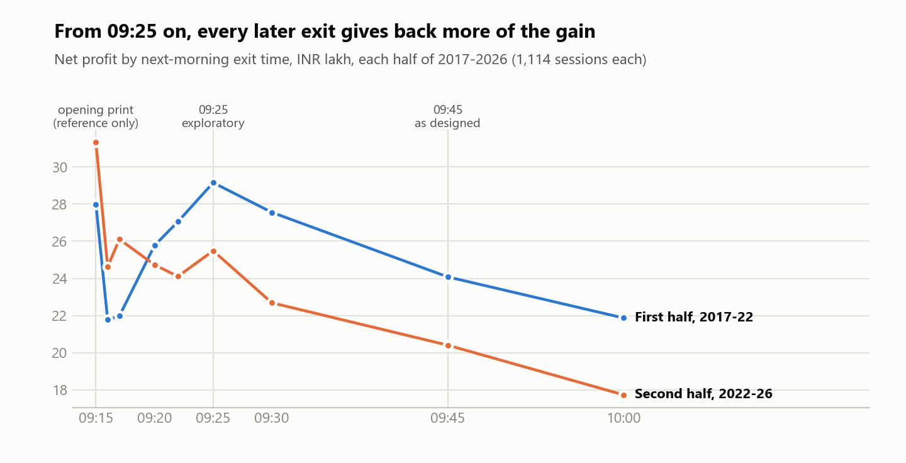
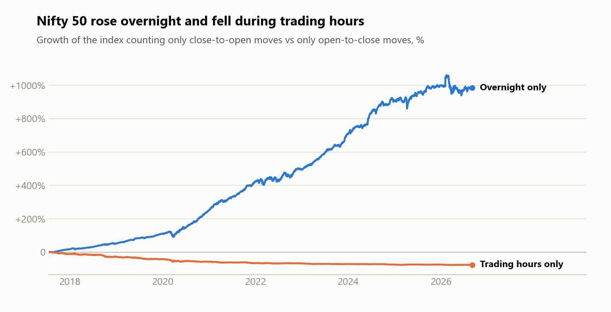

# ORB and the Overnight Drift Phenomenon in the Nifty 50 Index

A Nifty 50 opening-range breakout that holds overnight made **₹44.5 lakh on ₹10 lakh** from 2017 to 2026. This study takes the system apart piece by piece to find out *why*.

The answer is not the breakout. **The profit is the overnight gap**: the move from one day's close to the next day's open. The breakout works because it picks which nights to hold. Take away the night and the system loses money. Take away the breakout and the night still pays, but much less. And the gain fades the longer the position is held after the next open.

This is a known statistical phenomenon, the **overnight drift**. Over the same nine years, the Nifty 50 rose roughly tenfold counting only its overnight moves, and lost three-quarters counting only its trading hours.

<picture>
  <source media="(prefers-color-scheme: dark)" srcset="figures/1-system-equity-dark.png">
  
</picture>

---

**Contents**
[1. The system](#1-the-system) ·
[2. Where the profit comes from](#2-where-the-profit-comes-from) ·
[3. Remove the night](#3-remove-the-night) ·
[4. Remove the breakout](#4-remove-the-breakout) ·
[5. Move the exit clock](#5-move-the-exit-clock) ·
[6. The phenomenon in the whole index](#6-the-phenomenon-in-the-whole-index) ·
[7. What didn't explain it](#7-what-didnt-explain-it) ·
[8. Limitations](#8-limitations) ·
[9. Reproduce it](#9-reproduce-it)

---

## 1. The system

Long only, on the Nifty 50 index, using one-minute candles.

1. **Opening range:** the highest price between 09:15 and 09:44.
2. **Entry:** a 15-minute candle closes above that high, and the candle before it closed at or below it. Buy at the next minute's open. The earliest possible entry is 10:00, the last is 14:30.
3. **Stop:** 4 × ATR(14) of the 15-minute candles below entry (at least 10 points). **Target:** twice that distance above entry. Neither one moves.
4. **Exit:** if neither the stop nor the target is hit, sell at **09:45 the next morning**.
5. At most two trades a day, one at a time. Fixed size of 260 units (4 lots of 65). Costs of 3 index points each way.

The full rules, with every tie-break, are in [docs/SYSTEM_RULES.md](docs/SYSTEM_RULES.md).

**Data:** one-minute Nifty 50 index candles (`NSE:NIFTY50-INDEX`) from the **FYERS** broker's historical data API, 17 July 2017 to 3 September 2026. In-sample is July 2017 – December 2022; out-of-sample is January 2023 – September 2026.

| | In-sample 2017–2022 | Out-of-sample 2023–Sep 2026 | Full history |
|---|---:|---:|---:|
| Net profit | ₹29.10 lakh | ₹15.39 lakh | ₹44.50 lakh |
| Trades | 700 | 487 | 1,187 |
| Profit factor | 1.43 | 1.25 | 1.34 |
| Sharpe ratio (daily) | 1.66 | 1.01 | 1.35 |
| Largest drawdown | ₹3.82 lakh | ₹3.80 lakh | ₹3.82 lakh (18.6%) |

How the rules were chosen (23,040 variations tested, with the top five frozen before out-of-sample testing) is in [docs/HOW_IT_WAS_FOUND.md](docs/HOW_IT_WAS_FOUND.md).

**A first clue:** of the 1,187 trades, **1,024 were held overnight**, and 919 ended at the 09:45 deadline. Only 220 hit the stop and 48 the target. The stop and target rarely decide the outcome. The clock does.

## 2. Where the profit comes from

Every trade can be split exactly into five parts:

- **Entry day:** the move from entry to that day's close (or to the exit, if the trade closed the same day).
- **Overnight gap:** the move from the close to the next morning's 09:15 open.
- **Target cap at the open:** a gap that opens above the target is filled only at the target, so part of the gap is never collected.
- **Next morning:** the move from the 09:15 open to the actual exit.
- **Costs.**

<picture>
  <source media="(prefers-color-scheme: dark)" srcset="figures/2-profit-attribution-dark.png">
  
</picture>

| ₹ lakh | Entry day | Overnight gap | Target cap | Next morning | Costs | **Net** |
|---|---:|---:|---:|---:|---:|---:|
| In-sample | +10.73 | +35.88 | −1.53 | −5.06 | −10.92 | **+29.10** |
| Out-of-sample | +2.86 | +34.01 | −4.14 | −9.75 | −7.60 | **+15.39** |
| Full history | +13.59 | +69.89 | −5.66 | −14.81 | −18.52 | **+44.50** |

The overnight gap alone is larger than the entire net profit. Without it, the entry-day gains barely cover costs: −₹0.19 lakh in-sample and −₹4.73 lakh out-of-sample. **The next morning is negative in both periods.** Once the market opens, the position gives back part of what it gained overnight. Every year from 2017 to 2026 had a positive overnight gap component.

## 3. Remove the night

The attribution above is accounting. The direct test is to run the system again with **the same entries, stops and targets**, but close every position at **15:25 the same day**. All 1,187 entry times stay identical; only the holding period changes.

<picture>
  <source media="(prefers-color-scheme: dark)" srcset="figures/3-overnight-vs-same-day-dark.png">
  
</picture>

| | In-sample | Out-of-sample |
|---|---:|---:|
| Held overnight (the system) | +₹29.10 lakh, Sharpe 1.66 | +₹15.39 lakh, Sharpe 1.01 |
| Closed at 15:25 | **−₹0.38 lakh**, Sharpe −0.03 | **−₹3.52 lakh**, Sharpe −0.32 |

The breakout signal on its own, traded intraday, has no edge after costs. **All of the system's profit depends on holding through the night.**

## 4. Remove the breakout

If the night is the edge, why not hold every night? To test this, both sides use the same plain rule: **buy at 15:25, sell at 09:45 next morning, no stop, no target**, with 6 points of cost. One side does it every night. The other does it only on nights when the system was holding a position at 15:25. That choice uses only information available before 15:25.

<picture>
  <source media="(prefers-color-scheme: dark)" srcset="figures/4-which-nights-dark.png">
  
</picture>

| | Nights | Net | Sharpe | Avg per trade | Largest drawdown |
|---|---:|---:|---:|---:|---:|
| **In-sample** | | | | | |
| Every night | 1,295 | ₹17.63 lakh | 0.90 | 5.2 pts | ₹6.59 lakh |
| Only the system's nights | 598 | ₹21.13 lakh | 1.64 | 13.6 pts | ₹3.10 lakh |
| **Out-of-sample** | | | | | |
| Every night | 900 | ₹2.91 lakh | 0.16 | 1.2 pts | ₹8.83 lakh |
| Only the system's nights | 428 | ₹16.00 lakh | 1.33 | 14.4 pts | ₹2.12 lakh |

The drift is there on every night. Simply holding the index overnight was profitable. But the nights the breakout picks are far better: out of sample, they average **+30.7 points of overnight gap, against −0.6 on the other nights**.

**Could a random set of nights do this?** Each test draws 5,000 random sets of nights, the same number as the system, matched by year and weekday. Out of sample, **none of the 5,000** produced an average gap as large as the system's nights. **Three of 5,000** matched their average net return. A block bootstrap puts the out-of-sample gap advantage at **+17.3 to +46.0 points** (95% interval). In-sample, the advantage is smaller but still positive: +10.7 points, interval +2.9 to +18.8.

So the breakout is a **night selector**. A strong afternoon breakout that is still running at 15:25 marks the nights when the overnight drift has tended to be strongest.

## 5. Move the exit clock

If the gain arrives in the gap and fades after the open, the exit time should matter. Here the system is run again with only the next-morning exit time changed, from 09:15 to 10:00. Every run from 09:15 to 09:45 has **exactly the same 1,187 entries**. The history is split into two halves of 1,114 sessions each, to see whether the pattern repeats.

<picture>
  <source media="(prefers-color-scheme: dark)" srcset="figures/5-exit-clocks-dark.png">
  
</picture>

| Exit | Full net | Sharpe | First half | Second half | vs 09:45 | Given back after the open |
|---|---:|---:|---:|---:|---:|---:|
| 09:15 † | ₹59.31 L | 1.87 | ₹27.99 L | ₹31.32 L | +14.81 | 0 |
| 09:16 | ₹46.39 L | 1.46 | ₹21.77 L | ₹24.62 L | +1.90 | −12.91 |
| 09:17 | ₹48.09 L | 1.50 | ₹21.98 L | ₹26.10 L | +3.59 | −11.22 |
| 09:20 | ₹50.50 L | 1.58 | ₹25.77 L | ₹24.73 L | +6.01 | −8.80 |
| 09:22 | ₹51.17 L | 1.59 | ₹27.05 L | ₹24.11 L | +6.67 | −8.14 |
| **09:25 ‡** | **₹54.64 L** | **1.69** | ₹29.15 L | ₹25.49 L | **+10.14** | −4.67 |
| 09:30 | ₹50.24 L | 1.55 | ₹27.55 L | ₹22.69 L | +5.75 | −9.06 |
| **09:45 (as designed)** | **₹44.50 L** | **1.35** | ₹24.08 L | ₹20.41 L | 0 | −14.81 |
| 10:00 § | ₹39.61 L | 1.23 | ₹21.87 L | ₹17.74 L | −4.88 | −16.41 |

What this shows:

- **The overnight gain is collected at the open, then partly given back.** Every run from 09:15 to 09:45 captures the same ₹64.23 lakh of overnight gap. The only difference between them is how much is given back afterwards.
- **From 09:25 onward, every later exit gives back more.** 09:25 → 09:30 → 09:45 → 10:00 falls steadily in both halves.
- **09:25 beats 09:45 by almost the same amount in each half:** +₹5.07 lakh and +₹5.08 lakh. A paired block bootstrap puts the daily difference at +0.92 to +2.59 points (95% interval).
- **The first minutes after the open are noisy.** 09:16 and 09:17 are worse than 09:25 and differ between halves. The opening minutes are volatile, so exiting immediately is not automatically best.

> **The 09:25 exit, and every alternative clock here, is exploratory.** It was tested after the system was built, on the same history. The system as designed exits at 09:45. A reader may choose to run it with a 09:25 exit or with 09:45 as designed; that is their choice.

† 09:15 is the index's opening print. It is shown as a reference for "the moment the gap is known" and cannot be traded as a futures fill.
‡ Exploratory.
§ At 10:00 the exit can fall in the same minute as a new entry signal, so 113 entries are lost and 43 different ones taken. Its trade list is not identical to the others.

## 6. The phenomenon in the whole index

The system is one way to harvest the overnight drift. The drift itself shows up in the Nifty 50 with no system at all. Below, every complete session from July 2017 to September 2026 is split into its **overnight move** (previous close to 09:15 open) and its **trading-hours move** (09:15 open to the close).

<picture>
  <source media="(prefers-color-scheme: dark)" srcset="figures/6-nifty-overnight-vs-daytime-dark.png">
  
</picture>

| Nifty 50, 2017–2026 | Overnight | Trading hours |
|---|---:|---:|
| Sessions | 2,196 nights | 2,228 days |
| Share of moves that were up | 65.1% | 47.8% |
| Average move | +10.9 bp | −6.5 bp |
| Typical size (standard deviation) | 60.6 bp | 81.8 bp |
| Compounded over the period | **+984%** | **−76%** |

*(1 bp = 0.01%. Only complete sessions are used; a night is counted only when both sessions on either side of it are in the data.)*

Two out of three nights opened higher. On average the index **gained while the market was closed and lost while it was open**. The overnight moves were also smaller and steadier than the trading-hours moves. All of the index's net rise in this period happened overnight.

**This is not unique to India.** The pattern was first documented in US markets and has been studied for nearly two decades:

- **Cliff, Cooper & Gulen (2008),** *Return Differences between Trading and Non-Trading Hours: Like Night and Day* (working paper). Across US stocks, ETFs and index futures from 1993 to 2006, returns were strongly positive overnight and close to zero or negative during trading hours.
- **Kelly & Clark (2011),** *Returns in trading versus non-trading hours: The difference is day and night*, Journal of Asset Management 12(2), 132–145. For the QQQ ETF from 1999 to 2006, close-to-open returns were strongly positive and open-to-close returns strongly negative.
- **Lou, Polk & Skouras (2019),** *A tug of war: Overnight versus intraday expected returns*, Journal of Financial Economics 134(1), 192–213. The overnight and intraday components of returns behave as if driven by different groups of investors, and many well-known strategies earn their returns entirely in one of the two.
- **Boyarchenko, Larsen & Whelan (2023),** *The Overnight Drift*, Review of Financial Studies 36(9), 3502–3547. US equity returns are concentrated in the hours around the European open, linked to dealers' inventory risk after the previous US close.

Published long-run evidence for the Nifty 50 specifically is thin. This section measures it directly.

**An intuition, not a tested claim:** while India is closed, information keeps arriving: overnight news, the US session, global markets. None of it can be traded on Nifty until the open, so it arrives all at once in the opening gap. Once the market opens and that information is priced in, part of the move tends to fade. This study does not test *what* drives the drift. It treats the drift as a statistical regularity and measures how the system captures it.

## 7. What didn't explain it

Two earlier attempts to find the edge elsewhere both failed. They are summarised here for completeness. Their code and data are not part of this repository.

| Idea | What was tested | Result |
|---|---|---|
| Tune the breakout | 85 variations of range length (15/30/45 min), stop (3/4/5 ATR), target (1.5/2/2.5R) and filters. Best candidate chosen on 2017–2021, checked on 2022. | Failed the 2022 check (Sharpe 0.48 vs 0.76 original). Original rules kept. |
| Filter nights by green candles | Hold only nights when most one-minute candles that day (09:15–15:24) closed up. | On the system's nights (held 15:25 to 09:16), out-of-sample Sharpe fell from 1.58 to 0.99. Rejected. |

Both point the same way. The breakout's parameters are not where the edge lives; it lives in which nights are held, and for how long.

## 8. Limitations

### First: is this luck?

23,040 configurations were searched to find this system. A search that size always turns up something that looks good by chance. The deflated Sharpe ratio measures that risk, and on its own (≈ 40%, below the usual 95% bar) it would call the result unproven.

But the search was never a hunt for a lucky curve. It was a way to **learn how the Nifty behaves**: fit many different ideas to a fixed window of data, see which work and which don't, then test the survivors hard to find out *why*. Sections 2 to 6 are that second step, and they produce evidence the deflated Sharpe ratio cannot see:

- **The profit has one identifiable source.** It comes from the overnight gap, not from tuned settings. Changing the breakout's parameters didn't improve it (section 7). Changing only the holding period wiped it out (section 3).
- **That source exists without the system.** The Nifty 50 itself rose overnight and fell during trading hours (section 6). The same effect has been documented in US markets for nearly two decades. Nobody fitted it to this data.
- **The system selects nights better than chance.** Out of sample, none of 5,000 random sets of nights matched the gaps on the system's nights (section 4).

A configuration that was merely lucky would have no reason to make its money in one specific, independently documented part of the day. The deflated Sharpe ratio counts how many ideas were tried. It does not ask whether the winner's profit has a cause. This study does, and finds one. More on the approach is in [docs/HOW_IT_WAS_FOUND.md](docs/HOW_IT_WAS_FOUND.md).

What the mechanism does not settle is the future: whether the breakout will keep picking the better nights, and whether the overnight drift itself will persist. Those are the open questions. The remaining limitations are practical ones.

### Practical limitations

- **Index prices, not futures.** The simulation trades the Nifty 50 index price. Real Nifty futures have basis, roll dates, margin and their own opening prices. A futures check is pending.
- **The out-of-sample period was looked at during research.** The system was picked from five frozen candidates after their 2023+ results were seen. That makes it a reused out-of-sample period, not a blind test.
- **Multiple testing.** The deflated Sharpe ratio of about 40% stands as the measure of selection risk from the search alone. Read it together with the mechanism evidence above, not instead of it ([details](docs/HOW_IT_WAS_FOUND.md)).
- **Alternative exit times are exploratory.** The 09:25 result was found on the same history it is reported on.
- **A falling, sideways market since late 2024.** The Nifty 50 closed at 26,185 on 26 September 2024 and fell 15.7% by March 2025. It recovered to a marginal new high of 26,336 in January 2026, then fell to 22,379 by March 2026. At the end of the data it was 7.5% below its September 2024 level. In that market the overnight drift itself almost vanished: +1.8 bp a night on average, against +13.4 bp before, with 54% of nights opening higher, against 68%. The system's night selection kept working. Its nights still gapped up +29.6 points on average, while the other nights gapped down −16.6. There was simply much less drift to collect. Net profit was ₹2.54 lakh in 2025 and ₹1.03 lakh in 2026 to September, against ₹7.99 lakh in 2024. Over the whole stretch from October 2024 the system made ₹1.99 lakh. That is the weakest two-year stretch in the record: no earlier two-year period earned as little. Risk stayed within its historical bounds: the deepest drawdown (₹3.80 lakh, August 2025) did not exceed the 2020 crash record (₹3.82 lakh), and the account made a new high in August 2026.
- **Data handling.** 31 sessions with incomplete or repaired data are excluded. Positions are closed at 15:25 before an excluded session or a calendar gap longer than four days. That uses knowledge of the dataset, not a live rule.
- **Fixed size.** 260 units throughout, with no compounding and no historical lot-size changes.
- **The 09:15 "open"** is the index's first one-minute candle open after the pre-open session, not an official settlement price.

This is a historical research record, not trading advice.

## 9. Reproduce it

**Start with [`notebooks/walkthrough.ipynb`](notebooks/walkthrough.ipynb).** It rebuilds every number on this page, section by section, from the tables in `results/`. It needs no market data, so anyone can run it, and GitHub shows it with all outputs.

```
pip install -r requirements.txt
jupyter notebook notebooks/walkthrough.ipynb
python -m pytest tests                   # the fill and timing rules, on made-up prices
python src/make_figures.py               # every chart, from the tables in results/
python src/build_results.py --source NIFTY_1MIN.csv --repairs REPAIRS.csv   # every table, from raw data
```

- `src/orb_overnight.py`: the system, the same-day twin, the night controls, the profit split and the statistical tests, in one readable module.
- `src/build_results.py`: rebuilds everything in `results/` from one-minute data.
- `results/`: every number on this page. Trade log, daily P&L, attribution, night-by-night returns, exit-clock runs and test outputs.

**Raw market data is not included.** The original data is one-minute Nifty 50 index candles from the FYERS broker, for personal use. Rebuilding `results/` needs your own Nifty 50 one-minute candles (columns `DATE, TIME, Open, High, Low, Close`). The rebuilt results were checked against the original research runs: every trade, every model, every bootstrap interval and every shuffle-test p-value matched exactly.
